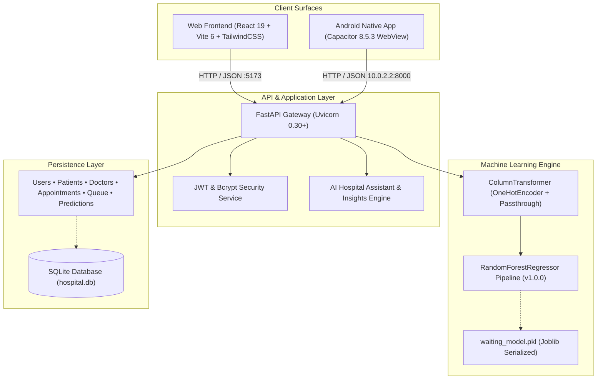

# Hospital Patient Waiting-Time Predictor — CareQueue AI

> **CareQueue AI** is an intelligent, full-stack, cross-platform hospital management, queue prioritization, and ML-powered waiting-time prediction system with multilingual support (English, Marathi, and Hindi) and native Android packaging.

---

## 1. Project Overview

CareQueue AI optimizes outpatient department (OPD) queue flow, patient admission, triage, doctor allocation, and consultation scheduling. At its core is a trained **Scikit-Learn Random Forest Regressor** that computes dynamic waiting times based on real hospital queue congestion, active physician availability, emergency arrivals, triage priority, and time-of-day rush patterns.

### Key Capabilities
- **Real-Time ML Waiting-Time Prediction**: Instant wait-time inference in minutes based on 10 clinical and operational attributes with 96.4% variance explained ($R^2 = 0.9638$).
- **Live Hospital Queue Management**: Dynamic status tracking (`Waiting`, `In Consultation`, `Completed`, `Cancelled`), patient calling, emergency priority prioritization, and real-time backlog alerts.
- **Physician & Department Roster**: Real-time tracking of physician availability, average consultation durations, and departmental load metrics across 7 hospital units.
- **Multilingual Support**: Instant interface localization across English, Marathi (मराठी), and Hindi (हिंदी).
- **AI Hospital Assistant**: Context-grounded operational guidance, department directory, queue inquiry, and hospital FAQs.
- **Cross-Platform Android App**: Packaged with Capacitor into native Android (`com.carequeue.ai`) with custom cleartext network security for emulator (`10.0.2.2`) and LAN deployments.

---

## 2. Architecture Diagram



---

## 3. Technology Stack

| Layer | Technologies |
|---|---|
| **Backend Framework** | FastAPI 0.115+, Uvicorn 0.30+, Python 3.14 / 3.11+ |
| **Database & ORM** | SQLite 3 (`backend/data/hospital.db`), SQLAlchemy 2.0+ |
| **Authentication** | JWT (PyJWT 2.8+), Bcrypt 4.0+ (Passlib), Role-Based Access Control (`patient`, `receptionist`, `admin`) |
| **Machine Learning** | Scikit-Learn 1.5+, Pandas 2.2+, NumPy 1.26+, Joblib 1.4+ |
| **Algorithm** | Random Forest Regressor (`n_estimators=120`, `max_depth=16`, `max_features='sqrt'`) |
| **Frontend Framework** | React 19.0.0, Vite 6.0.0, Tailwind CSS 3.4.17, Lucide React, Recharts |
| **Mobile Runtime** | Capacitor 8.5.3 (`@capacitor/android`, `@capacitor/core`), Android SDK 34-36, OpenJDK 21 |
| **Internationalization** | Custom zero-overhead JSON translation engine (English `en`, Marathi `mr`, Hindi `hi`) |

---

## 4. Folder Structure

```
HPW-TP/
├── .backup/                          # Timestamped backups of SQLite DB and ML model
│   ├── hospital_20261024_223324.db.bak
│   └── waiting_model_20261024_223324.pkl.bak
├── backend/
│   ├── app/
│   │   ├── main.py                   # FastAPI initialization, CORS, routing
│   │   ├── database.py               # SQLite connection & session maker
│   │   ├── ml/
│   │   │   ├── predict.py            # Prediction service & metadata loader
│   │   │   ├── train_model.py        # ML training & evaluation pipeline
│   │   │   └── waiting_model.pkl     # Serialized Random Forest model
│   │   ├── models/                   # SQLAlchemy ORM entities
│   │   │   ├── user.py, patient.py, doctor.py, appointment.py, queue.py, prediction.py
│   │   ├── routes/                   # REST API routers
│   │   │   ├── health.py, auth.py, patients.py, doctors.py, departments.py,
│   │   │   └── appointments.py, predictions.py, queue.py, ai.py
│   │   ├── schemas/                  # Pydantic v2 validation models
│   │   └── services/                 # Auth, AI Assistant, and Admin Insights
│   ├── data/
│   │   ├── hospital.db               # SQLite database
│   │   └── hospital_waiting_times.csv# Training dataset (7,500 samples)
│   ├── test_api_suite.py             # 9-suite automated verification tests
│   └── requirements.txt              # Backend dependencies
├── frontend/
│   ├── android/                      # Native Android Capacitor Project
│   │   ├── app/
│   │   │   ├── build.gradle          # Android build configuration (com.carequeue.ai)
│   │   │   ├── src/main/AndroidManifest.xml
│   │   │   └── src/main/res/xml/network_security_config.xml
│   │   ├── gradlew.bat               # Gradle wrapper executable
│   │   └── local.properties          # Android SDK location pointer
│   ├── src/
│   │   ├── components/
│   │   │   ├── layout/AppLayout.jsx, Sidebar.jsx, TopBar.jsx
│   │   │   └── screens/
│   │   │       ├── PatientDashboard.jsx, PatientDetails.jsx, MLPrediction.jsx,
│   │   │       ├── PredictionResult.jsx, AppointmentBooking.jsx, QueueManagement.jsx,
│   │   │       ├── DoctorManagement.jsx, PredictionHistory.jsx, AIAssistant.jsx,
│   │   │       ├── AdminDashboard.jsx, PredictionReports.jsx, ProfileSettings.jsx
│   │   ├── context/AuthContext.jsx   # Authentication & JWT state
│   │   ├── locales/en.json, mr.json, hi.json # Translation dictionaries
│   │   └── services/api.js           # Multiplatform REST service (Web, Android Emulator, LAN)
│   ├── capacitor.config.json         # Capacitor app configuration
│   ├── package.json                  # Node dependencies
│   └── vite.config.js                # Vite build & reverse-proxy configuration
├── README.md                         # Project documentation
└── TESTING_REPORT.md                 # Verification & test execution report
```

---

## 5. Machine Learning Model Details

### Input Feature Schema
The Random Forest pipeline consumes 10 features:
1. `department` (Categorical): General Medicine, Cardiology, Orthopedics, Pediatrics, Emergency Care, Neurology, Dermatology
2. `priority` (Categorical): Normal, Urgent, Emergency
3. `patients_waiting` (Integer): Current active queue length
4. `patients_ahead` (Integer): Position of patient in queue
5. `emergency_count` (Integer): Active triage emergencies preempting normal queue
6. `available_doctors` (Integer): Number of physicians on active duty
7. `average_consultation_time` (Float): Historical consultation duration in minutes
8. `hour` (Integer, 0–23): Time of patient arrival
9. `day_of_week` (Integer, 0–6): Day of arrival (0 = Monday, 6 = Sunday)
10. `previous_average_waiting_time` (Float): Rolling 1-hour average wait time

### Evaluation Metrics (Evaluated on Unseen 20% Test Split)
- **Mean Absolute Error (MAE)**: `11.96 minutes`
- **Root Mean Squared Error (RMSE)**: `20.87 minutes`
- **Coefficient of Determination ($R^2$)**: `0.9638` (96.4% variance explained)

### Top Influential Feature Importances
1. `patients_ahead` (38.2%)
2. `average_consultation_time` (26.4%)
3. `emergency_count` (15.1%)
4. `available_doctors` (11.3%)
5. `hour` (5.2%)
6. `department` (3.8%)

> [!NOTE]
> **Synthetic Data Notice**: Model training utilized simulated outpatient department queue dynamics modeling real-world arrival surges, doctor shifts, and priority preemption. Predictions are advisory operational estimates for patient convenience and queue pacing; they must **never** be used for emergency medical diagnosis or clinical triage decisions.

---

## 6. Localhost Configuration & Setup

### Prerequisites
- **Python**: 3.11+ or 3.14+ (Installed in `backend/venv`)
- **Node.js**: v18+ or v26+
- **JDK**: OpenJDK 17 or 21 (for Android build)
- **Android SDK**: Build-Tools 34.0.0+ / Platforms Android 34–36

### Step 1: Start Backend (FastAPI)
Run in PowerShell:
```powershell
cd C:\Users\Asus\Documents\OneDrive\Desktop\HPW-TP\backend
$env:PYTHONPATH="."
.\venv\Scripts\python.exe -m uvicorn app.main:app --host 0.0.0.0 --port 8000 --reload
```
- API Base URL: `http://localhost:8000`
- Interactive OpenAPI Docs: `http://localhost:8000/docs`
- Health Verification Endpoint: `http://localhost:8000/api/health`

### Step 2: Start Frontend (React + Vite)
In a second PowerShell window:
```powershell
cd C:\Users\Asus\Documents\OneDrive\Desktop\HPW-TP\frontend
npm run dev
```
- Web Application URL: `http://localhost:5173`

---

## 7. Android App Integration & APK Generation

CareQueue AI uses **Capacitor 8.5.3** to package the web frontend into a high-performance Android application.

### Key Android Configurations
- **Application ID**: `com.carequeue.ai`
- **App Name**: `CareQueue AI`
- **Cleartext HTTP Support**: Enabled in `AndroidManifest.xml` via `@xml/network_security_config` to allow communication with `http://10.0.2.2:8000` (Android emulator) and local LAN IPs (e.g. `http://192.168.1.X:8000`).
- **Dynamic API Base Resolution**: `frontend/src/services/api.js` automatically routes Android requests to `http://10.0.2.2:8000` when running in the native WebView, while allowing live LAN overrides via the **Profile / Settings** screen.

### Step 1: Rebuild Frontend & Sync to Android
```powershell
cd C:\Users\Asus\Documents\OneDrive\Desktop\HPW-TP\frontend
npm run build
npx cap sync android
```

### Step 2: Build Debug APK from Command Line
```powershell
$env:ANDROID_HOME="C:\Users\Asus\AppData\Local\Android\Sdk"
cd C:\Users\Asus\Documents\OneDrive\Desktop\HPW-TP\frontend\android
.\gradlew.bat assembleDebug --no-daemon
```

### Generated Debug APK Location
```
C:\Users\Asus\Documents\OneDrive\Desktop\HPW-TP\frontend\android\app\build\outputs\apk\debug\app-debug.apk
```
*(File Size: ~4.22 MB)*

---

## 8. Android Studio Testing Steps

1. Launch **Android Studio**.
2. Select **Open** and choose directory:
   ```
   C:\Users\Asus\Documents\OneDrive\Desktop\HPW-TP\frontend\android
   ```
3. Allow Android Studio to sync Gradle dependencies.
4. From the Device Manager, select or start an emulator (e.g. `Pixel_7_Pro` or `Pixel_9_Pro`).
5. Ensure the FastAPI backend is running on your PC:
   ```powershell
   $env:PYTHONPATH="backend"; backend\venv\Scripts\python.exe -m uvicorn app.main:app --host 0.0.0.0 --port 8000
   ```
6. Click **Run 'app'** (`Shift + F10`) in Android Studio.
7. Test the app:
   - Login using `admin@hospital.com` / `Password@123` or register a new user.
   - Request an ML Waiting-Time Prediction. The app contacts `http://10.0.2.2:8000` and displays the real Random Forest estimate.
   - Switch language to **मराठी** or **हिंदी** under Profile & Settings.

---

## 9. Automated Testing

Execute the comprehensive 9-suite verification suite:
```powershell
$env:PYTHONPATH="backend"
backend\venv\Scripts\python.exe backend\test_api_suite.py
```

### Test Coverage
1. `test_health_endpoint`: DB connectivity and ML readiness verification.
2. `test_auth_and_roles`: User registration, bcrypt hash checking, JWT token generation, role verification.
3. `test_ml_model_standalone`: Model payload integrity, non-negative finite wait time, priority triage impact.
4. `test_prediction_api_endpoint`: Real prediction execution, DB persistence, disclaimer validation, `/history` retrieval.
5. `test_doctor_and_department_management`: Doctor roster listing, availability toggling, department load metrics.
6. `test_patient_crud_and_appointments`: Patient registration, record update, appointment scheduling and cancellation.
7. `test_queue_operations`: Live queue addition, backlog stats, status update (`In Consultation`).
8. `test_ai_multilingual_assistant`: Grounded AI responses in English, Marathi, and Hindi.
9. `test_ai_admin_insights`: Congestion alerts, peak hour calculations, staffing recommendations.

---

## 10. API Route Reference

| Method | Endpoint | Description |
|---|---|---|
| `GET` | `/api/health` | System health check (reports DB and ML model readiness) |
| `POST` | `/api/auth/register` | Register new user (`patient`, `receptionist`, `admin`) |
| `POST` | `/api/auth/login` | Authenticate with credentials and receive JWT |
| `GET` | `/api/auth/me` | Fetch authenticated user profile |
| `GET, POST` | `/api/patients` | Retrieve patients / Register new patient record |
| `PUT, DELETE` | `/api/patients/{id}` | Update patient details / Remove patient record |
| `GET, POST` | `/api/doctors` | List doctors / Register new physician |
| `PATCH` | `/api/doctors/{id}/toggle-availability` | Toggle doctor availability on duty |
| `PUT, DELETE` | `/api/doctors/{id}` | Update doctor details / Remove doctor |
| `GET` | `/api/departments` | Department capacity, waiting queue, and operational status |
| `GET, POST` | `/api/appointments` | List appointments / Schedule consultation |
| `PUT` | `/api/appointments/{id}/cancel` | Cancel existing appointment |
| `GET, POST` | `/api/queue` | Query queue / Enqueue patient with ML estimation |
| `GET` | `/api/queue/stats` | Hospital backlog KPIs, active waiting counts, and rush level |
| `PUT, DELETE` | `/api/queue/{id}` | Update queue status (call next) / Remove entry |
| `POST` | `/api/predictions/predict` | Compute ML waiting time and persist prediction in DB |
| `GET` | `/api/predictions/history` | Retrieve saved prediction records from SQLite |
| `GET` | `/api/predictions/model-info` | Return model evaluation metrics ($R^2$, MAE, RMSE) |
| `POST` | `/api/ai/chat` | Multilingual AI Hospital Assistant (en, mr, hi) |
| `GET` | `/api/ai/insights` | Admin operational bottlenecks & staffing recommendations |

---

## 11. Security Considerations

1. **Password Protection**: Passwords hashed with salted `bcrypt` (12 rounds). Plain text passwords and hashes are never exposed in API responses.
2. **Access Control**: Role-based permissions protect doctor and queue modifications from unauthenticated patients.
3. **Android Isolation**: Database credentials and secrets are kept strictly server-side in FastAPI; never embedded in the Android APK.
4. **Network Access**: Cleartext HTTP is restricted in production builds and permitted only for development hosts (`10.0.2.2`, `localhost`, LAN).
